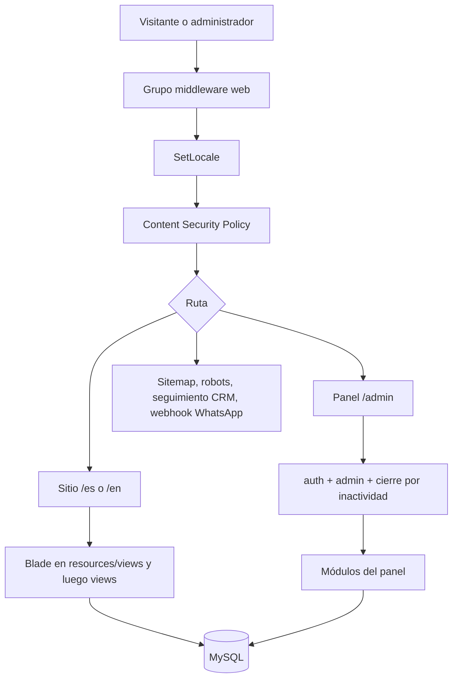

# Arquitectura del sitio CloudLab Latam

Documento de la aplicación web pública y del área de administración. Describe los módulos que están en uso. Las copias bajo `tests/` y `routes/resources/` no forman parte del sitio que se ejecuta.

## 1. Qué es

Sitio bilingüe (español e inglés) de CloudLab Latam. Presenta servicios de automatización, analítica y datos sobre Microsoft Power Platform, publica blog y proyectos, y recibe consultas. El mismo código incluye el panel de administración y un CRM para empresas, contactos, negocios, actividades y campañas de correo.

El dominio público es `https://cloudlablatam.tech`. El correo de contacto es `info@cloudlablatam.com`.

## 2. Stack

| Capa | Tecnología |
| --- | --- |
| Aplicación | Laravel 9, PHP 8 |
| Vistas | Blade |
| Sitio público | Bootstrap 5, CSS propio (`public/css/brand.css`, `cloudlab.css`, `cloud-bot.css`) |
| Administración | Blade + Bootstrap, JavaScript propio del CRM |
| Base de datos | MySQL (`db_cloudlab` en local) |
| Correo | SMTP de Hostinger (`smtp.hostinger.com`) |
| Autenticación del panel | Sesión de Laravel. El acceso exige `users.is_admin` |
| API pública | No hay una API de negocio. `routes/api.php` solo expone el usuario de Sanctum |

La aplicación no usa Livewire, Filament, Statamic ni un paquete de localización. El idioma, el SEO y las páginas de servicio están resueltos en el propio código.

## 3. Cómo entra una petición

Middleware del grupo `web`, en este orden relevante: cookies cifradas, sesión, CSRF, `SetLocale`, `ContentSecurityPolicy`.

Las vistas se buscan primero en `resources/views` y después en `views/`. Si existe el mismo nombre en los dos sitios, gana `resources/views`. El layout público está en `views/layouts/app.blade.php`. El del panel está en `views/admin/layouts/app.blade.php`.

## 4. Idioma

Todas las páginas públicas viven bajo `/{locale}`, con `locale` igual a `es` o `en`.

- `/` y las rutas antiguas sin idioma redirigen de forma permanente a `/es/...`.
- `SetLocale` toma el idioma de la URL. Si no viene, usa la sesión y, si tampoco hay sesión, el idioma por defecto (`es`).
- Los textos de interfaz están en `lang/es/messages.php` y `lang/en/messages.php`.
- Los slugs de servicios son los mismos en los dos idiomas. El texto de cada servicio cambia según el locale.
- Los proyectos guardan campos en español y en inglés (`title` / `title_en`, y lo mismo para descripción, contenido, SEO y tecnologías).
- El formulario de contacto fija el idioma de los dos correos con el segmento de la URL (`/es` o `/en`), no con el idioma del navegador.

## 5. Módulos públicos

### 5.1 Inicio

Ruta: `/{locale}` (`HomeController`).

Reúne proyectos destacados publicados, los tres artículos más recientes y las tecnologías activas. También muestra la calculadora de tiempo recuperable, el proceso de trabajo y el formulario de consulta. Los datos que faltan (tabla no creada o error de consulta) no tumban la página: se registran y la sección queda vacía.

### 5.2 Servicios

Rutas: `/{locale}/servicios` y `/{locale}/servicios/{slug}` (`ServiceController`).

No salen de la base de datos. El catálogo está en `config/seo_services.php`, con copia en español e inglés, preguntas frecuentes y palabras clave. Los slugs actuales son:

- `automatizacion-power-automate`
- `power-bi-analitica`
- `microsoft-fabric-ingenieria-de-datos`
- `rpa`

Cada ficha puede enlazar un proyecto publicado cuyas palabras coincidan con las del servicio.

### 5.3 Blog

Rutas: listado, ficha por slug, ficha por id, valoración y comentario.

- Solo se listan artículos con `is_published`.
- La ficha acepta valoración y comentarios. Esas dos acciones tienen límite de frecuencia.
- Los comentarios nuevos quedan pendientes. En el sitio solo se ven los aprobados (`is_approved`).
- La imagen destacada se sirve desde `public/images/`, no desde el disco de storage.

### 5.4 Proyectos

Rutas: listado y ficha por slug. Solo entran los publicados. Un proyecto puede marcarse como destacado para la portada. El contenido mostrado depende del idioma activo.

### 5.5 Tecnologías

Ruta: `/{locale}/technologies`. Lista las tecnologías activas, ordenadas por `display_order` y nombre. Los iconos se muestran de inmediato, sin espera de carga perezosa.

### 5.6 Nosotros, documentación y cookies

- `/{locale}/about`: página institucional.
- `/{locale}/documentation`: página de documentación estática.
- `/{locale}/cookies`: política de cookies. El aviso de consentimiento vive en el layout público.

### 5.7 Contacto y Cloud Bot

Rutas: `/{locale}/contact` (GET y POST). El formulario de la portada envía al mismo `contact.store` con `return_to=home`.

Cloud Bot es el asistente del layout público (`resources/views/components/cloud-bot.blade.php`). Puede abrir el mismo envío de contacto por JSON. No es un modelo de lenguaje propio: responde con textos fijos y, si hace falta, muestra el formulario.

Secuencia de un envío válido:

1. El visitante envía el formulario.
2. Se aplican las comprobaciones: CSRF, campo señuelo, antigüedad del token del formulario, Turnstile si hay claves, límite de envíos, y validación de nombre, correo, empresa y mensaje.
3. Se generan un número de referencia (`CL-fecha-código`) y se envían dos correos en el idioma de la página:
   - aviso interno a `info@cloudlablatam.com`;
   - confirmación a la dirección que escribió el visitante.

Si el aviso interno falla, el visitante ve un error. Si solo falla la confirmación, la consulta ya quedó enviada y la página igual muestra éxito. El correo se manda en el momento, sin cola.

Turnstile permanece apagado mientras `TURNSTILE_SECRET_KEY` esté vacío, para no rechazar envíos reales antes de tener las claves de Cloudflare.

### 5.8 SEO técnico

- `sitemap.xml` (`SitemapController`) arma el mapa con las páginas públicas, servicios, artículos y proyectos publicados.
- `robots.txt` (`RobotsController`) apunta al sitemap.
- `SEOService` y los metadatos de blog, proyecto y servicio completan título, descripción y datos estructurados.

### 5.9 Seguimiento de campañas

Rutas públicas, sin sesión de administrador:

- `/t/o/{token}` registra una apertura.
- `/t/c/{token}` registra un clic y redirige.
- `/t/u/{token}` registra una baja.

### 5.10 WhatsApp

`GET` y `POST /webhooks/whatsapp` hablan con la API de WhatsApp Cloud. La verificación usa el token configurado. Los mensajes entrantes pasan por `LeadConversation`, que guarda el estado en `whatsapp_conversation_states` y puede avisar por correo cuando queda un lead. Esta ruta no lleva el idioma del sitio ni la sesión del panel.

## 6. Área de administración

Dirección: `/admin`. No lleva prefijo de idioma.

### 6.1 Acceso

| Pieza | Función |
| --- | --- |
| `GET /admin/login` | Formulario de ingreso |
| `POST /admin/login` | Ingreso, con límite de 5 intentos por minuto |
| `POST /admin/logout` | Cierre de sesión |
| Middleware `auth` | Exige una sesión iniciada |
| Middleware `admin` | Exige `users.is_admin`. Si no, vuelve al login |
| Middleware `admin.timeout` | Cierra la sesión tras 5 minutos sin actividad |

`is_admin` no se puede asignar por asignación masiva del modelo `User`.

El menú del panel está en `views/admin/layouts/app.blade.php`: tablero, blog, comentarios, proyectos, tecnologías, base de conocimiento, contraseña, CRM, campañas y salida.

### 6.2 Tablero

`GET /admin/dashboard`. Muestra cuántos artículos, proyectos y tecnologías hay. No es el CRM.

### 6.3 Blog

`/admin/blogs` es un recurso completo: listar, crear, ver, editar y borrar.

- El cuerpo se edita con el editor de texto enriquecido del panel.
- `POST /admin/blogs/upload-image` sube imágenes del contenido.
- La imagen destacada se guarda para servirse desde `public/images/`.
- Cada artículo tiene título, slug, extracto, contenido, SEO, estado de publicación y autor.

### 6.4 Comentarios del blog

`/admin/blog-comments`.

- Lista los comentarios, incluidos los que aún no están aprobados.
- Aprobar los publica en la ficha del artículo.
- Eliminar los quita.

### 6.5 Proyectos

`/admin/projects` es un recurso completo, más `POST /admin/projects/upload-image`.

Además de los campos en español, el formulario tiene la versión en inglés. Se puede marcar destacado y publicado, y asociar tecnologías, URL del caso y URL de código.

### 6.6 Tecnologías

`/admin/technologies` lista, crea, edita y borra. No tiene ficha de detalle en el panel. Cada registro tiene nombre, icono, orden y si está activo. Solo las activas salen al sitio.

### 6.7 Base de conocimiento

`/admin/knowledge-base` lista, crea, edita y borra. Las entradas tienen orden de presentación. Este módulo no tiene una página pública: hoy solo existe dentro del panel.

### 6.8 Contraseña

`/admin/settings/password` permite al administrador autenticado cambiar su propia contraseña.

### 6.9 CRM

Entrada: `/admin/crm` (`AdminCrmController`). Empresas, contactos y negocios se trabajan desde ese tablero. Las rutas antiguas `/admin/crm/companies`, `/admin/crm/contacts` y `/admin/crm/deals` redirigen al tablero.

El enlace del menú puede apuntar a una URL externa si `app.crm_flask_url` está definida. Si no, abre este CRM de Laravel. Hay una carpeta `crm_flask/` en el repositorio; el CRM que usa el panel por defecto es el de Laravel.

#### Empresas

Tabla `crm_companies`. Alta, edición, borrado y borrado masivo desde el tablero. Una empresa agrupa contactos y negocios.

#### Contactos

Tabla `crm_contacts`. Nombre, correo, teléfono, cargo, etapa del ciclo de vida, origen, puntaje, empresa, responsable y notas.

Acciones: alta, edición, borrado, borrado masivo, correo individual y consulta de campañas en las que participó.

#### Correo de un contacto

`POST /admin/crm/contacts/{contact}/email` envía un correo a esa persona y deja constancia en `crm_email_messages`.

La bandeja de respuestas no se lee en cada clic. El comando `crm:fetch-inbox` corre cada diez minutos, se conecta por IMAP y registra las respuestas. Un correo de respuesta puede avisar al responsable.

#### Negocios

Tabla `crm_deals`. Título, monto, probabilidad, fecha prevista de cierre, contacto, empresa y responsable.

Etapas: prospección, calificación, propuesta, negociación, ganada y perdida. El valor ponderado es el monto por la probabilidad.

#### Actividades

Tabla `crm_activities`. Tareas o seguimientos ligados al trabajo comercial. Alta, edición y borrado desde el tablero.

#### Importación

`POST /admin/crm/import` carga un CSV de empresas o contactos (`CrmCsvImporter`). Hay plantillas descargables por tipo. El comando `crm:import-csv` hace la misma carga desde la consola.

#### Campañas

Rutas bajo `/admin/crm/campaigns`.

- Listar, crear, ver, enviar y borrar una campaña.
- El cuerpo puede salir de una plantilla guardada, de una plantilla inicial o de HTML subido.
- Se pueden subir imágenes del mensaje.
- Al enviar, `CampaignSender` y el job `SendCampaignBatch` reparten el correo. Cada destinatario lleva tokens de apertura, clic y baja.
- El estado y los conteos (enviados, fallidos, aperturas, clics, bajas) quedan en `crm_campaigns`, `crm_campaign_recipients` y `crm_campaign_events`.
- Quien se da de baja queda en `crm_email_unsubscribes` y no vuelve a entrar en un envío.

## 7. Datos principales

| Tabla | Uso |
| --- | --- |
| `users` | Cuentas. `is_admin` abre el panel |
| `blogs` | Artículos |
| `blog_comments` | Comentarios, con aprobación |
| `blog_ratings` | Valoraciones |
| `projects` | Casos, con campos en inglés |
| `technologies` | Iconos y nombres del sitio |
| `knowledge_base` | Entradas solo de administración |
| `crm_companies` | Empresas |
| `crm_contacts` | Personas |
| `crm_deals` | Negocios |
| `crm_activities` | Actividades |
| `crm_email_messages` | Correos individuales y respuestas |
| `crm_campaigns` | Campañas |
| `crm_campaign_recipients` | Destinatarios y tokens |
| `crm_campaign_events` | Aperturas, clics y bajas |
| `crm_email_templates` | Plantillas de campaña |
| `crm_email_unsubscribes` | Bajas |
| `whatsapp_conversation_states` | Estado de la conversación de WhatsApp |

## 8. Correo

Todo el correo sale por SMTP con la cuenta de la marca. El remitente es la dirección configurada en `MAIL_FROM_ADDRESS`.

Hay cuatro usos:

1. Aviso interno del formulario de contacto (`ContactMessage`).
2. Confirmación al visitante (`ContactConfirmation`), en el idioma de la página.
3. Correo individual del CRM y respuestas de bandeja.
4. Campañas, con seguimiento de apertura, clic y baja.

El formulario no copia el mensaje otra vez a la bandeja por IMAP. Esa copia duplicaba el aviso interno. La lectura IMAP queda reservada al CRM, para traer respuestas.

## 9. Seguridad que afecta a la arquitectura

- CSRF en los formularios del grupo `web`. El webhook de WhatsApp es la excepción conocida.
- El panel no se abre solo con estar autenticado: hace falta `is_admin`, y la sesión del administrador caduca a los cinco minutos.
- El formulario de contacto tiene señuelo, token con tiempo mínimo y máximo, límite por IP, validación de formato y, cuando esté configurado, Turnstile.
- Las páginas públicas envían una política de seguridad de contenido. Los scripts y estilos propios llevan nonce. Los orígenes permitidos incluyen el CDN de Bootstrap y, si se usa, Cloudflare Turnstile.
- Los campos de texto del blog y de los proyectos pasan por `SanitizesInput` antes de guardarse.

## 10. Dónde vive cada cosa en el código

| Carpeta | Contenido |
| --- | --- |
| `app/Http/Controllers` | Sitio público |
| `app/Http/Controllers/Admin` | Panel, incluido `Admin/CRM` |
| `app/Models` | Blog, proyectos, tecnologías, usuarios |
| `app/Models/CRM` | Entidades comerciales |
| `app/Mail` | Plantillas de correo que se envían |
| `app/Support` | Idioma, marca, Turnstile, campañas, WhatsApp, importación |
| `app/Jobs/SendCampaignBatch.php` | Envío por lotes de una campaña |
| `lang/es` y `lang/en` | Textos de la interfaz y de los correos de contacto |
| `config/seo_services.php` | Páginas de servicio |
| `views/` y `resources/views/` | Plantillas. La primera carpeta de `config/view.php` gana |

## 11. Operación

En producción la aplicación Laravel está fuera de la raíz web. `public_html` es la cara pública y arranca el framework que vive en `laravel_app`. La base y el correo se leen del entorno de ese servidor. El programador de tareas previsto es `crm:fetch-inbox` cada diez minutos; hace falta que el cron del servidor llame a `schedule:run`.
